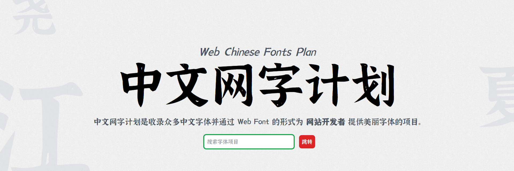
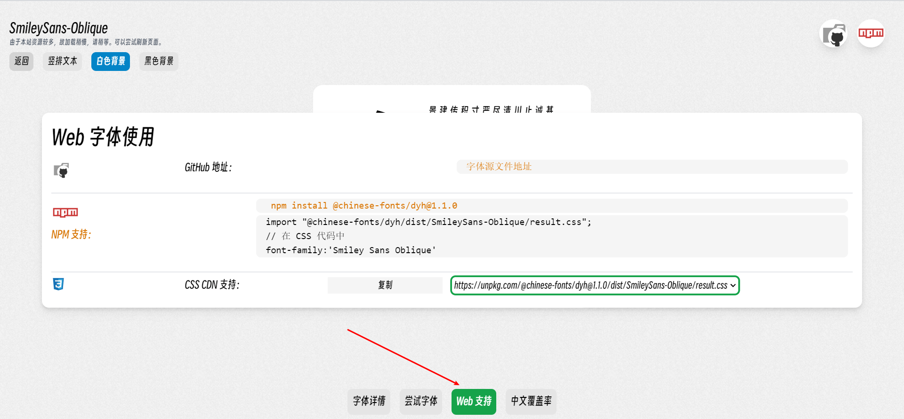

# 中文网字计划 v6

[Netlify 网页](https://chinese-font.netlify.app/)

[新模块 - font-now (直接上传并获取字体 CDN 链接)](https://font-now.netlify.app/)<br />

[](https://app.netlify.com/sites/chinese-font/deploys)

## 简介

这是一个收集免费可商用的 **Web 字体文件** 的 GitHub 项目！在网页中，由于中文字符庞大的特性，能够被兼容和使用的中文字体非常有限。所以我们的项目使用了特殊的中文字体切割方式，使得任何网站都可以全站全文本字体覆盖！

中文网字计划期望在网络中为实现中文字体的繁荣而努力。为此，我们进行了大规模中文字体网络化的研究和实践，实现了许多字体工具和解决方案。

1. [中文字体切割插件 @konghayao/cn-font-split](https://github.com/KonghaYao/cn-font-split)
2. [支持 Vite、Next、Nuxt、Webpack 的 vite-plugin-font](https://www.npmjs.com/package/vite-plugin-font)
3. [支持用户自定义上传字体的字体 CDN 服务](https://github.com/KonghaYao/font-now)

开发者只需要将字体源文件放置在 packages 文件夹下，项目将自动打包和分组。已发布到 NPM，欢迎广大开发者使用！

## 我如何用？

> 如果你是开发者，可以在官网查看字体，并且获取 Web 支持，直接引用 CSS 文件即可使用。
>
> 如果你是设计师，需要原始字体文件，你可以点击 Github 图标跳转下载



## 代码贡献者

<a href="https://github.com/KonghaYao/chinese-free-web-font-storage/graphs/contributors">
  
</a>

## 技术相关

1. 字体部署方案由 [cn-font-split](https://github.com/Konghayao/cn-font-split) 项目提供。从项目初始， cn-font-split 就作为中文网字计划的功能提供，帮助我们实现了网络字体的合理部署。
2. [Imagekit.io](https://imagekit.io/) 网站为我们的字体提供了静态文件解决方案，我们的字体部署于 Imagekit.io。
3. 中文网字计划期待有一个公益的 CDN 能够持续提供免费的字体服务，像 Google Font 一样支持广大开发者。

## Material Icons 和 Google Fonts

Material Icons 和 Google Fonts 提供了非常良好的静态字体相关的服务给我们，但是部分地区并没有较好的方式进行 Google Fonts 的查看。

所以我们将 Google Fonts 的查询功能直接内置在我们的网页中，方便大家查询相关的 CSS 链接。其中采用了 FontSource 的 NPM 静态仓库进行相关数据和文件的获取，感谢 FontSource。

## 开发与合作

## 开发者文档

为了防止我忘记上传与部署方式，我将说明写在了 Developer.md 文件中。

## 您想要添加字体？

> 我们只接收免费商用的字体

### 直接提交一个 issue

1. 在 Issue 面板上标明字体链接和授权信息即可

### 提交一个 PR

> 注意，需要 node 18 以上的版本

1. 准备字体链接和授权信息
2. fork 该项目

```sh
npm i # 安装项目
```

3. 按下面的代码启动

```sh
npm run new dyh # dyh 是字体的中文拼音的第一个英文组合
# 完成后将会在 packages 文件夹自动模板创建一个 dyh 文件夹

# 然后你在 packages/dyh/fonts 文件夹中放入您的字体文件

pnpm build --single=dyh  # 尝试打包文件

```

4. 提交 PR ，我们将会人工审核并上传字体

## 注意事项

1. 有些中文字体没有英文部分，所以需要英文部分可以结合 Google Fonts 进行使用。
2. 使用 result.css 引入时，在同一个 DOM 上赋值两种字体可能会导致错误。

## 证书

### 仓库证书

MIT License

### 字体版权

请您尊重字体制作者的权益，我在制作的时候特地将字体文件的头部信息导出到了字体详情中，您可以详细查看制作者和授权等相关的数据。


## 🌐 Web Resources & Aesthetic Symbols Index
- [SYM 1F47B](https://soft-angel-symbols-21.pages.dev/symbol/sym-1f47b/)
- [SYM 1F61C](https://coquette-aesthetic-symbols-96.pages.dev/symbol/sym-1f61c/)
- [SYM 2764 FE0F 200D 1FA79](https://synth-dystopia-text-20.pages.dev/symbol/sym-2764-fe0f-200d-1fa79/)
- [SYM 273C](https://kawaii-kaomoji-hub-12.pages.dev/symbol/sym-273c/)
- [SYM 1F92B](https://ballet-core-symbols-11.pages.dev/symbol/sym-1f92b/)
- [SYM 26E6](https://sleek-type-aesthetic-51.pages.dev/symbol/sym-26e6/)
- [SYM 1F640](https://ribbon-heart-symbols-17.pages.dev/symbol/sym-1f640/)
- [SYM 1F602](https://mecha-gamer-fonts-53.pages.dev/symbol/sym-1f602/)
- [SYM 1F974](https://pastel-kaomoji-vault-54.pages.dev/symbol/sym-1f974/)
- [SYM 1F62A](https://glitch-matrix-fonts-28.pages.dev/symbol/sym-1f62a/)
- [SYM 1D492](https://vintage-lace-symbols-65.pages.dev/symbol/sym-1d492/)
- [SYM 1D499](https://cyber-clan-tags-41.pages.dev/symbol/sym-1d499/)
- [SYM 1D408](https://kawaii-kaomoji-hub-89.pages.dev/symbol/sym-1d408/)
- [SYM 1D41E](https://soft-girl-fancy-text-11.pages.dev/symbol/sym-1d41e/)
- [SYM 2639 FE0F](https://sleek-dot-symbols-31.pages.dev/symbol/sym-2639-fe0f/)
- [SYM 26BD](https://vintage-academic-symbols-10.pages.dev/symbol/sym-26bd/)
- [SYM 1F63A](https://anime-sparkle-text-21.pages.dev/symbol/sym-1f63a/)
- [MUSIC WEATHER](https://mech-gaming-tags-18.pages.dev/es/music-weather/)
- [SYM 1D45C](https://coquette-aesthetic-symbols-47.pages.dev/symbol/sym-1d45c/)
- [SYM 26E2](https://angelic-bio-symbols-90.pages.dev/symbol/sym-26e2/)
- [SYM 26AC](https://neon-futuristic-symbols-20.pages.dev/symbol/sym-26ac/)
- [SYM 26E4](https://anime-sparkle-text-45.pages.dev/symbol/sym-26e4/)
- [SYM 26FE](https://daintystar-font-studio-48.pages.dev/symbol/sym-26fe/)
- [SYM 1F635 200D 1F4AB](https://dark-scholarly-symbols-65.pages.dev/symbol/sym-1f635-200d-1f4ab/)
- [SYM 262F](https://gothic-bio-fonts-84.pages.dev/symbol/sym-262f/)
- [SYM 1F606](https://vintage-academic-symbols-10.pages.dev/symbol/sym-1f606/)
- [SYM 1F979](https://vintage-library-symbols-27.pages.dev/symbol/sym-1f979/)
- [SYM 1D459](https://synthwave-bio-maker-62.pages.dev/symbol/sym-1d459/)
- [BORDERS DIVIDERS](https://sleek-line-unicode-29.pages.dev/borders-dividers/)
- [SYM 1D492](https://cyber-clan-tags-20.pages.dev/symbol/sym-1d492/)
- [MUSIC FLAT SIGN](https://gothic-bio-fonts-61.pages.dev/symbol/music-flat-sign/)
- [SYM 267D](https://classic-literature-symbols-64.pages.dev/symbol/sym-267d/)
- [SYM 1F49C](https://soft-pastel-unicode-78.pages.dev/symbol/sym-1f49c/)
- [TABLE FLIP RAGE KAOMOJI](https://dark-scholarly-symbols-65.pages.dev/symbol/table-flip-rage-kaomoji/)
- [SYM 1D47C](https://balletcore-cute-fonts-43.pages.dev/symbol/sym-1d47c/)
- [RIGHT MATHEMATICAL WHITE SQUARE BRACKET](https://neon-glitch-symbols-91.pages.dev/symbol/right-mathematical-white-square-bracket/)
- [UPWARD DIAGONAL ARROW](https://anime-sparkle-text-50.pages.dev/symbol/upward-diagonal-arrow/)
- [WHITE FLORETTE BLOSSOM](https://clean-aesthetic-fonts-74.pages.dev/symbol/white-florette-blossom/)
- [SYM 2674](https://neon-tech-unicode-43.pages.dev/symbol/sym-2674/)
- [SYM 26C4](https://vintage-bow-text-15.pages.dev/symbol/sym-26c4/)
- [SYM 2635](https://gothic-bio-fonts-55.pages.dev/symbol/sym-2635/)
- [HEARTS](https://matrix-glitch-text-59.pages.dev/es/hearts/)
- [SYM 1D425](https://minimal-star-symbols-95.pages.dev/symbol/sym-1d425/)
- [MUSIC WEATHER](https://neon-futuristic-symbols-62.pages.dev/music-weather/)
- [SYM 2733](https://synthwave-bio-maker-62.pages.dev/symbol/sym-2733/)
- [SYM 1D446](https://minimal-star-symbols-95.pages.dev/symbol/sym-1d446/)
- [SYM 1D450](https://gothic-bio-fonts-81.pages.dev/symbol/sym-1d450/)
- [SYM 1D472](https://classic-literature-symbols-64.pages.dev/symbol/sym-1d472/)
- [SYM 1F630](https://soft-angel-unicode-43.pages.dev/symbol/sym-1f630/)
- [SYM 2741](https://vampiric-text-craft-82.pages.dev/symbol/sym-2741/)
- [SYM 1D462](https://vintage-angel-text-38.pages.dev/symbol/sym-1d462/)
- [SYM 1D405](https://fairy-lace-symbols-92.pages.dev/symbol/sym-1d405/)
- [SYM 1D402](https://mecha-crosshair-tags-20.pages.dev/symbol/sym-1d402/)
- [SYM 1F626](https://baroque-font-vault-96.pages.dev/symbol/sym-1f626/)
- [SYM 1F634](https://mecha-matrix-symbols-75.pages.dev/symbol/sym-1f634/)
- [SYM 1D45E](https://classic-literature-symbols-64.pages.dev/symbol/sym-1d45e/)
- [SYM 268C](https://clean-unicode-text-35.pages.dev/symbol/sym-268c/)
- [SYM 1F495](https://monochrome-bio-text-12.pages.dev/symbol/sym-1f495/)
- [SYM 26D6](https://kawaii-kaomoji-hub-89.pages.dev/symbol/sym-26d6/)
- [SYM 26F0](https://manga-speech-symbols-95.pages.dev/symbol/sym-26f0/)
- [SYM 1D46D](https://cyber-clan-tags-41.pages.dev/symbol/sym-1d46d/)
- [SYM 1F639](https://neon-gamer-symbols-64.pages.dev/symbol/sym-1f639/)
- [SYM 1F641](https://sleek-dot-symbols-31.pages.dev/symbol/sym-1f641/)
- [SYM 1FAE1](https://matrix-terminal-fonts-30.pages.dev/symbol/sym-1fae1/)
- [SYM 26C5](https://gothic-bio-fonts-61.pages.dev/symbol/sym-26c5/)
- [SYM 1D491](https://gothic-bio-fonts-55.pages.dev/symbol/sym-1d491/)
- [VI](https://gothic-bio-fonts-69.pages.dev/vi/)
- [SYM 1F496](https://fairy-lace-symbols-92.pages.dev/symbol/sym-1f496/)
- [SYM 2637](https://clean-line-emojis-93.pages.dev/symbol/sym-2637/)
- [SYM 1F60E](https://vintage-academic-symbols-10.pages.dev/symbol/sym-1f60e/)
- [SYM 1F47D](https://gothic-bio-fonts-84.pages.dev/symbol/sym-1f47d/)
- [SYM 1D40E](https://minimal-star-symbols-95.pages.dev/symbol/sym-1d40e/)
- [SYM 2746](https://sleek-dot-symbols-31.pages.dev/symbol/sym-2746/)
- [SYM 2673](https://pink-bow-fonts-37.pages.dev/symbol/sym-2673/)
- [SYM 26A4](https://vintage-runic-symbols-53.pages.dev/symbol/sym-26a4/)
- [SYM 1D465](https://anime-sparkle-text-56.pages.dev/symbol/sym-1d465/)
- [SYM 1D414](https://minimal-star-symbols-95.pages.dev/symbol/sym-1d414/)
- [VIRGO ZODIAC MAIDEN](https://techno-hacker-text-43.pages.dev/symbol/virgo-zodiac-maiden/)
- [SYM 1F623](https://cyber-clan-tags-90.pages.dev/symbol/sym-1f623/)
- [TIKTOK CAPTIONS](https://kawaii-kaomoji-hub-77.pages.dev/vi/tiktok-captions/)
- [NATURE FLOWERS](https://grimoire-magic-symbols-81.pages.dev/ja/nature-flowers/)
- [SYM 260F](https://gothic-bio-fonts-61.pages.dev/symbol/sym-260f/)
- [INSTAGRAM BIO](https://vintage-angel-text-38.pages.dev/pt/instagram-bio/)
- [SYM 1F9D0](https://fairy-lace-symbols-92.pages.dev/symbol/sym-1f9d0/)
- [SYM 26F2](https://ribbon-heart-symbols-17.pages.dev/symbol/sym-26f2/)
- [SPRING TULIP BLOSSOM](https://dark-scholarly-symbols-65.pages.dev/symbol/spring-tulip-blossom/)
- [SYM 2684](https://clean-spacing-fonts-98.pages.dev/symbol/sym-2684/)
- [ROBLOX NAMES](https://vintage-academic-symbols-10.pages.dev/vi/roblox-names/)
- [SYM 1D479](https://kawaii-kaomoji-hub-89.pages.dev/symbol/sym-1d479/)
- [SPARKLE DOT FLARE](https://minimal-star-symbols-74.pages.dev/symbol/sparkle-dot-flare/)
- [SYM 2721](https://matrix-glitch-text-59.pages.dev/symbol/sym-2721/)
- [SYM 26EF](https://sleek-dot-symbols-31.pages.dev/symbol/sym-26ef/)
- [SYM 1D405](https://minimal-star-symbols-95.pages.dev/symbol/sym-1d405/)
- [COQUETTE BOW RIBBON](https://pastel-moe-emoticons-55.pages.dev/symbol/coquette-bow-ribbon/)
- [SYM 1D49C](https://gothic-bio-fonts-55.pages.dev/symbol/sym-1d49c/)
- [SYM 265A](https://mecha-text-vault-91.pages.dev/symbol/sym-265a/)
- [SYM 2764 FE0F](https://coquette-aesthetic-symbols-78.pages.dev/symbol/sym-2764-fe0f/)
- [SYM 26DD](https://classic-literature-symbols-64.pages.dev/symbol/sym-26dd/)
- [SYM 1F631](https://fairy-lace-symbols-92.pages.dev/symbol/sym-1f631/)
- [SYM 1D481](https://synthwave-bio-maker-62.pages.dev/symbol/sym-1d481/)
- [SYM 26C2](https://coquette-aesthetic-symbols-47.pages.dev/symbol/sym-26c2/)
- [SYM 2641](https://ribbon-bow-unicode-18.pages.dev/symbol/sym-2641/)
- [SYM 1D412](https://neon-futuristic-symbols-62.pages.dev/symbol/sym-1d412/)
- [SYM 1F62D](https://anime-sparkle-text-21.pages.dev/symbol/sym-1f62d/)
- [SYM 1F979](https://ribbon-bow-unicode-18.pages.dev/symbol/sym-1f979/)
- [BLACK FLORETTE FLOWER](https://dark-scholarly-symbols-65.pages.dev/symbol/black-florette-flower/)
- [SYM 1D415](https://minimal-star-symbols-95.pages.dev/symbol/sym-1d415/)
- [GAMING WEAPONS](https://angelic-ribbon-text-78.pages.dev/ru/gaming-weapons/)
- [SYM 260E](https://coquette-aesthetic-symbols-62.pages.dev/symbol/sym-260e/)
- [SYM 26F3](https://manga-speech-symbols-95.pages.dev/symbol/sym-26f3/)
- [TENDER GENTLE TEAR KAOMOJI](https://dark-scholarly-symbols-65.pages.dev/symbol/tender-gentle-tear-kaomoji/)
- [SYM 267B](https://anime-sparkle-text-56.pages.dev/symbol/sym-267b/)
- [CIRCLED STAR](https://minimal-star-symbols-74.pages.dev/symbol/circled-star/)
- [SYM 26E0](https://gothic-bio-fonts-24.pages.dev/symbol/sym-26e0/)
- [SYM 1F630](https://neon-glitch-fonts-25.pages.dev/symbol/sym-1f630/)
- [SPARKLE DOT FLARE](https://minimal-star-symbols-91.pages.dev/symbol/sparkle-dot-flare/)
- [SYM 26F1](https://manga-speech-symbols-95.pages.dev/symbol/sym-26f1/)
- [SYM 1D449](https://coquette-aesthetic-symbols-62.pages.dev/symbol/sym-1d449/)
- [SYM 1F973](https://pastel-kaomoji-vault-54.pages.dev/symbol/sym-1f973/)
- [SYM 1F644](https://clean-line-emojis-77.pages.dev/symbol/sym-1f644/)
- [RU](https://dark-scholarly-symbols-65.pages.dev/ru/)
- [UPWARD DIAGONAL ARROW](https://mecha-crosshair-tags-20.pages.dev/symbol/upward-diagonal-arrow/)
- [SYM 273E](https://sleek-line-unicode-29.pages.dev/symbol/sym-273e/)
- [SYM 2686](https://neon-glitch-fonts-25.pages.dev/symbol/sym-2686/)
- [SYM 265C](https://pink-bow-fonts-37.pages.dev/symbol/sym-265c/)
- [SYM 1D40F](https://minimal-star-symbols-95.pages.dev/symbol/sym-1d40f/)
- [SYM 1D49B](https://cyber-clan-tags-36.pages.dev/symbol/sym-1d49b/)
- [CRYING TEARS SAD KAOMOJI](https://ribbon-heart-symbols-17.pages.dev/symbol/crying-tears-sad-kaomoji/)
- [SYM 1D42E](https://cyber-clan-tags-41.pages.dev/symbol/sym-1d42e/)
- [SYM 1D427](https://manga-speech-symbols-95.pages.dev/symbol/sym-1d427/)
